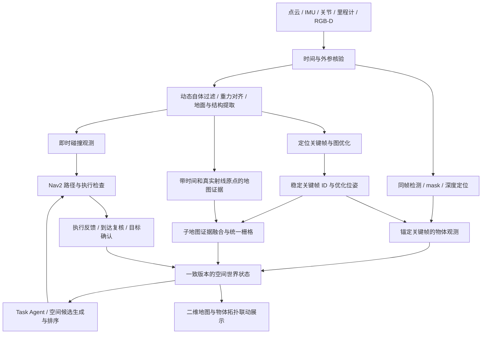

# Go2-W 建图质量、语义拓扑与任务决策完整整改执行计划

版本：v1.0  
日期：2026-10-23，Asia/Shanghai  
项目：`/home/mxt/robotscene`  
用途：交给后续 AI 直接开展实现、验证、部署准备与现场验收的工程任务书。  
当前状态：**诊断已完成，本计划尚未实施；不能把本文描述的目标架构当作现有能力。**

## 0. 给执行 AI 的总指令

用户要求解决三个相互关联的问题：

1. 当前二维导航地图轮廓破碎、自由空间稀疏，运动后建图和定位中断；需要得到真实、清晰、准确、能够用于导航的地图。
2. 二维地图与已有物体语义拓扑联动，维护已观测物体的位置、关系、所属地点、观测来源和位置不确定性。
3. 任务 Agent 使用地图、物体、拓扑、探索历史及导航反馈共同决策，并通过现有 Nav2 执行链完成搜索闭环。

当用户要求“按此计划执行”时，完成本文规定的实际修改与验证，不要只再生成一份计划。优先复用已有工程，分阶段完成同一条生产链，不能创建只在演示脚本中有效的新链路。遇到某阶段依赖现场条件时，先完成所有不依赖该条件的软件、历史数据回放和隔离验证，保留准确的未验收清单。

“一次性修好”指最终覆盖完整问题链、提供可复现证据，不代表一次修改即可跳过验证，也不保证在缺少运动数据、独立几何量测或现场授权时证明物理精度。

### 0.1 本文与历史资料的关系

- 当前用户直接指令、当前适用的仓库规则优先。
- 本文作为新的综合整改方案，供用户授权执行；历史任务书中的阶段性冻结清单、旧路线和旧验收状态需要按当时作用域理解，不能机械套用到这次综合整改。
- 旧文档中的 PID、boot ID、剩余动作次数、某个时刻的 HEALTHY 均为历史证据，不能当作当前运行状态。
- 本文不自动继承或扩大历史运动授权。若同一会话已经明确授权相同的有效运动范围，不要重复询问；核对现场条件与剩余额度后使用。
- 当前这次请求只要求生成 Markdown 计划书；**不构成代码实施、启动导航或运动授权**。

### 0.2 工作与现场边界

- 主机目录：`/home/mxt/robotscene`。
- 机器狗：`192.168.123.18`，用户名 `unitree`；设备可能重启或服务未启动，接手时只读核实。
- 认证信息由用户会话或本地安全认证方式提供，不把密码写入 Markdown、代码、日志或 Git。
- 原工作树存在大量修改、未跟踪文件和删除。先记录基线，不得整体 reset、checkout、clean，不得把已有修改算成本次修改。
- 不覆盖原始录制、旧地图、标定证据和运动账本；新证据使用新的运行目录。
- 用户授权实施后，代码修改、离线测试与只读检查应主动完成；运动前需要与实际范围匹配的有效授权及现场急停条件。
- 不通过修改账本、重开会话、重试退款、拆分动作等方式扩大运动范围。
- 不以放宽碰撞门限、删除未知空间约束、伪造新鲜时间戳、缩小机身外廓或强行置健康为 true 来“修复”。
- 不未经授权发站立、坐下、转向、前进、arm、解除急停等命令。只读采集程序不得隐式调用这些动作。

## 1. 已核实的诊断基线

### 1.1 指定失败会话

```text
outputs/live_runs/search_20261021_191421_09006207/
├── events.jsonl
├── webui_graph.json
├── webui_state.json
└── replay/
    ├── timeline.jsonl
    ├── poses.jsonl
    ├── capture_status.json
    ├── manifest.json
    ├── maps/*.npz
    └── artifacts/replay.mp4
```

任务：在前方通道寻找红色背包。结果为失败，回放质量为 PARTIAL。

| 核实项 | 已有证据 |
|---|---|
| 生产后端 | 会话参数为 `backend=nav2`、`spatial_provider=nav2` |
| 本次视觉后端 | 会话参数为 `detector=llm`；不能用当前 YAML 默认值反推历史运行 |
| 建图路线 | 宇树雷达点云 → 预处理 → 二维扫描/关键帧 → 自定义 slam_toolbox 适配器 → 地面可见区域补充 → `/map` |
| 地图尺寸 | 139 × 90，分辨率约 0.05 m，覆盖约 6.95 × 4.50 m |
| 最终格数 | unknown=10,317，free=1,955，occupied=238；自由面积约 4.8875 m² |
| 保存的地图 | 60 份 NPZ；并非 60 个独立 SLAM 关键帧 |
| 静止阶段 | 前约 75 秒，占用格维持 184 个且占用格数组位置不变；主要变化为 free/unknown |
| 地图原点 | 后期 Y 原点发生约 0.0279 m 变化；跨此前后比较必须按世界坐标对齐 |
| 时长 | 原始采集约 234 秒，地图内容约在录制第 78 秒后停止变化 |
| 有效扫描 | 运动前一个健康样本：mapping scan 457/720 个有效距离；collision scan 107/720 |
| 同日附近采样 | `cable_rerouted_new_map.json` 中 mapping scan 有效 bins 中位数 466/720；这是同日近邻采样，不冒充整段失败会话统计 |
| 目标执行 | 约 0.314 m 的局部目标，随后因 `localization lost during goal` 取消 |
| 姿态触发 | 第 11 关节偏差约 0.292023 rad，当时阈值 0.08 rad；随后第 5 关节约 0.081797 rad |
| 中断链路 | 姿态无效 → 停扫 → 约 0.147 秒后扫描新鲜度检查失败 → 导航取消 |
| 物体图 | 1 个地点、6 个物体、11 个前沿；6 个物体都有 map_xyz，均单次观测、TENTATIVE、bbox 深度来源 |
| 视觉延迟 | 一次 quick VLM 调用约 46.8 秒，另有 full semantic timeout |

数据来源：

- [失败会话事件](../outputs/live_runs/search_20261021_191421_09006207/events.jsonl)
- [物体与拓扑快照](../outputs/live_runs/search_20261021_191421_09006207/webui_graph.json)
- [回放时间线](../outputs/live_runs/search_20261021_191421_09006207/replay/timeline.jsonl)
- [运动姿态故障分析](../artifacts/go2w_continuation_after_reboot_20261021/motion_posture_failure_analysis.json)
- [真实健康采样](../artifacts/go2w_continuation_after_reboot_20261021/production_search_fixed_health.jsonl)
- [同日重建地图采样](../artifacts/go2w_continuation_after_reboot_20261021/cable_rerouted_new_map.json)
- [接续报告](../reports/go2w_cable_reroute_nav2_20261021.md)

### 1.2 必须纠正的理解

1. Nav2 是导航链的重要组成，但本次地图主要由 slam_toolbox 及自定义前后处理生成。优先查地图输入、坐标、时间、融合与定位，不能先把问题归到控制器调参。
2. 图中的灰色是未知，不是障碍；白色细条是自由空间证据。清晰不能靠把灰色全部涂白实现。
3. 本次主要表现并不支持“静止时持续大幅 SLAM 漂移”的结论：前约 75 秒障碍格不变。运动末期发生的小范围修正、失效区间需要单独分析。
4. 静止单点观测不能获得被墙或家具遮挡的完整房间。参考图的多个房间和长轨迹不能与本次覆盖面积直接对比。
5. 当前已有静止累积、关键帧筛选、语义物体 map_xyz 与重投影逻辑。要修复其限制与断点，不要宣称从零新增已存在的能力。
6. `map_valid`、`localization_valid`、`METRIC_LIDAR` 等现有字段不等于独立验证过地图精度或物体精度。
7. 当前 profile 的关节容差已改为 0.09 rad；这不覆盖运动中的 0.292 rad，也不证明动态自体模型适用。
8. 原始资料不足以逐个判定孤立黑点究竟是家具、自体还是噪声。必须保留待验证分类，不能直接全部删除。

### 1.3 故障与证据等级

| 编号 | 问题 | 等级 | 修复方向 |
|---|---|---|---|
| F01 | 姿态偏离静态参考导致停扫、定位失效 | 日志直接证实 | 动态自体模型、姿态适用性与输入新鲜度分离 |
| F02 | 静止时结构图不继续完善 | 代码及占用格历史共同支持 | 位姿优化与地图证据融合解耦 |
| F03 | 扫描角度缺测、结构覆盖不完整 | 真实有效 bins、地图共同支持 | 结构提取、带位姿观测融合、真实覆盖探索 |
| F04 | 跨帧取最小距离易保留偶发近回波 | 代码确定的风险，尚未逐点归因 | 时间一致性、稳健观测模型，不影响即时避障 |
| F05 | 地面补图仅近场且不清占用 | 代码确定 | 统一有来源的空间证据融合 |
| F06 | `semantic_relevance` 全部写成 0 | 生产调用直接证实 | 真实对象—地点—前沿关联与评分 |
| F07 | task_agent 主要做摘要，未收到完整空间决策上下文 | 接口与调用直接证实 | 统一世界状态和唯一最终决策记录 |
| F08 | 历史物体重投影只依赖最新统一 map→odom | 代码确定的长期限制，非本次已证实失效根因 | 关键帧/子地图锚定与优化后重建 |
| F09 | 单次 bbox 深度物体估计无法证明精确位置 | 本次产物直接证实 | 同帧 mask、稳健深度、多视角关联及不确定性 |
| F10 | 大模型调用阻塞决策数十秒 | 事件直接证实 | 异步语义、时效检查与及时的几何导航链 |

## 2. 目标、非目标与完成定义

### 2.1 最终应交付的行为

- 机器人静止时，已可观测区域的地图证据能收敛，机器人位姿不因反复匹配相同扫描而漂移。
- 在已验证的运动姿态范围内，扫描、定位和建图连续；真实输入失效时停止导航并保留可诊断原因。
- 机器人移动到新观察位置后，地图能够增长、连接通道，并在回环后保持一致。
- 地图、物体、地点、前沿共享同一地图身份和一致的优化版本。
- 每个物体有稳定 ID、测量来源、采集时间、坐标系、位置估计和不确定性；未知位置为 null。
- 拓扑关系参与实际搜索候选评估，而不是仅用于显示连线。
- Task Agent 能选择目标观察点、锚点附近区域、前沿或历史地点；Nav2 处理实际可达性和执行。
- 用户可以在二维地图上看到物体和探索状态，并在拓扑图中选中同一对象进行联动。
- 找到目标必须满足已有目标身份和最终观察判据；任务完成后停车；失败原因能够追溯。

### 2.2 非目标

- 不保证知道未观察到的所有物体位置，不把常识推测当作测量。
- 不要求静止在起点生成多个房间的完整地图。
- 不默认更换成新 SLAM、不默认增加新硬件、不为此次工作建立第二套生产控制链。
- 不把参考截图的墙线风格当作精度指标，不对用于导航的地图做无依据的美化填充。
- 不新增抓取、搬运、碰撞或追逐能力。

### 2.3 完成等级

使用四级状态，最终报告逐项标记：

- `IMPLEMENTED`：代码和生产接线完成。
- `OFFLINE_VERIFIED`：纯函数、录制回放和隔离 ROS 验证完成。
- `LIVE_READONLY_VERIFIED`：当前真实传感器与真实规划链只读验证完成。
- `FIELD_ACCEPTED`：在授权现场完成真实运动、地图精度及搜索闭环验收。

完整交付要求关键目标达到 `FIELD_ACCEPTED`。缺现场条件时可以交付软件阶段成果，但必须明确“未完成现场验收”，不能把未做项目标绿。

## 3. 关键代码导航

路径是接手索引，不保证行号不变；先查当前版本和实际安装版本。

| 子系统 | 首要文件 |
|---|---|
| 生产启动 | `scripts/go2w/start_nav2_autonomous_search.sh`、`start_live_perception.sh`、`start_2d_localization.sh` |
| 二维定位启动 | `ros2_ws/src/robot_scene_nav_bringup/launch/localization_2d.launch.py` |
| SLAM 参数与适配器 | `ros2_ws/src/robot_scene_nav_bringup/config/slam_2d_mapping.yaml`、`src/keyframe_slam_toolbox.cpp` |
| 雷达预处理 | `ros2_ws/src/go2w_lidar_preprocessor/go2w_lidar_preprocessor/preprocessor_node.py`、`preprocess_core.py` |
| 自体、地面、累积 | 同目录 `self_returns.py`、`floor_attitude.py`、`mapping_scan_accumulator.py` |
| 几何配置 | `configs/go2w/navigation_sensor_profile.yaml`、`lidar_preprocess.yaml`、`time_sync.yaml` |
| TF 配置 | `ros2_ws/src/go2w_description/launch/official_sensor_frames.launch.py` 及相邻配置加载模块 |
| 地面补图 | `ros2_ws/src/robot_scene_nav_bringup/scripts/observed_floor_map.py`、`app/navigation/floor_visibility.py` |
| 健康 | `ros2_ws/src/robot_scene_nav_bringup/scripts/localization_health_monitor.py`、`app/navigation/localization_health.py` |
| 地图提供者 | `app/spatial/nav2_spatial_provider.py`、`plain_slam_spatial_provider.py`、`app/slam/slam_bridge.py` |
| 深度定位 | `app/perception/depth_object_localizer.py`、`realsense_http_rgbd_source.py` |
| 物体、关系、地点 | `app/spatial/semantic_object_map.py`、`semantic_entity_graph.py`、`place_graph.py`、`geometric_relation_extractor.py` |
| 搜索主链 | `scripts/go2w/run_semantic_exploration.py` |
| 空间与任务决策 | `app/reasoning/semantic_navigation/spatial_reasoner.py`、`task_agent.py`、`models.py` |
| 目标与路径 | `app/navigation/long_term_goal_selector.py`、`semantic_route_planner.py`、`viewpoint_planner.py`、`local_goal_executor.py` |
| Nav2 后端 | `app/navigation/nav2_search_backend.py`、`nav2_candidate_geometry.py` |
| 前沿与记忆 | `app/spatial/frontier_extractor.py`、`spatial_memory.py` |
| Web 展示 | `app/manual_web_demo/`、`app/spatial/object_display_snapshot.py`、`semantic_object_gate.py` |
| 回放 | `app/search_replay/`、`scripts/go2w/record_search_replay_ros.py` |

配置审计必须追踪：YAML → 环境变量 → Web 请求体 → worker argv → ROS 实际参数 → 实际执行二进制。当前 YAML 中部分 plain_slam 注释/默认值与该失败会话的 nav2 参数不一致，不能只改一个 YAML 就声称生产生效。

## 4. 目标架构与接口不变量



### 4.1 发布权与地图层职责

- `map→odom_fused` 只允许一个已选定的定位/SLAM 权威。
- `odom_fused→base_link` 维持现有唯一里程计权威，不能让新增融合节点再发布一份。
- `/map` 只允许一个生产发布者。
- 现有 `/go2w/slam/map_raw` 可保留为 slam_toolbox 原生地图，供诊断、基线对比及内部定位一致性检查。
- 新增地图融合若独立实现，应先在影子话题输出；验证后由启动器明确选择唯一 `/map` 来源，停用被替代的地面补图发布路径。
- `/go2w/lidar/scan` 的低延迟避障职责保留，不使用长窗口累积结果替代即时避障。
- 静态结构地图、碰撞 costmap、语义物体层职责分明；语义不存在或定位失败不能被解释为几何自由空间。

### 4.2 坐标、时间、版本

所有空间产物必须可以追溯到：

```text
map_id             持久地图身份
map_epoch          本次坐标/定位连续性周期
graph_revision     关键帧优化位姿版本
grid_revision      观测融合栅格版本
semantic_revision  物体及关系版本
frame_id           坐标系
source_stamp       原始采集时间及所用时钟域
sensor_profile_id  外参与几何配置摘要
```

- 接收时间、采集时间、推理完成时间分别保存；不能用接收时间掩盖旧数据。
- 不同地图/epoch 的同名 `map` 不代表相同坐标系。
- 栅格原点移动、地图扩大、分辨率变化时，缓存和物体投影必须正确更新。
- `snapshot_id` 绑定相容的多个 revision；允许语义较旧，但必须显式标注其年龄和锚点变换是否有效。
- 世界快照更新应使用不可变快照或受控锁，不让一次决策读到一半新图、一半旧对象。
- 地图优化发生时旧计划需要重新检查；不要求微小每帧更新都取消导航，但必须定义触发条件。

## 5. P0：基线、生产接线与可复现诊断

### 工作项

1. 读取适用仓库规则，记录 git HEAD、工作树状态与本次会修改文件的原始摘要。
2. 只读核对主机及机器狗 boot、当前进程、ROS 版本、域、实际节点、话题发布者与 TF 权威。
3. 比较 `src`、`build/install`、实际进程路径和参数；识别未重建、未部署、仍运行旧进程的问题。
4. 保存失败会话基线统计；禁止为了复算而重写它的 manifest、地图或视频。
5. 建立只读诊断脚本：给定会话目录输出地图元信息、有效扫描比例、姿态失效时间、定位中断、物体状态和实际决策输入。
6. 地图比较先按 frame、epoch、resolution、origin 对齐；输出未知/自由/占用变化和有效观察 ROI，而不是直接逐数组相减。
7. 汇总当前可用历史原始点云、关节/IMU、TF、RGB-D 数据，区分“只有二维 map”“原始点云齐全”“具备同步运动数据”。

### 产物

```text
artifacts/go2w_map_semantic_fix_<运行标识>/
  baseline/
    workspace_state.txt
    runtime_identity.json
    resolved_configuration.json
    original_run_metrics.json
    data_inventory.json
    evidence_hashes.json
```

### 验收

- 能复算第 1 节的关键基线，并注明采样窗口差异。
- 任何缺失文件或过期运行状态都显式标记；不从旧报告猜实时状态。
- 后续实验均有源数据摘要、代码版本、配置摘要和结果路径。

## 6. P1：动态几何、时间与连续扫描

### 6.1 先确认几何，而不是直接放宽站姿阈值

核查以下问题：

- 雷达点云的实际 frame、轴方向、单位、时间语义及是否已被上游去畸变。
- 相机 optical frame 与机身 frame 的转换，RGB-depth 对齐与内参来源。
- base→LiDAR、base→camera 水平平移和 yaw 是否仍为估计；地面拟合不能单独约束全部水平外参。
- IMU、关节和点云的真实采集时间映射；同进程接收时间相近只说明通信到达接近。
- 安装设备、雷达支架、线缆是否与旧标定一致。

增加或复用静态多平面/已知物体实验，至少验证前方、侧方、多个距离及保留验证集。若数据不足，输出具体未观测自由度和待采集清单，不凭一次纸箱拟合宣称外参全部通过。

### 6.2 自体过滤目标实现

默认方案：固定机身设备模型 + 关节驱动的腿/轮模型。

1. 读取已核对的 Go2-W URDF、关节顺序、限位与单位，构建每个 link 在点云采集时刻的位姿。
2. 利用 collision geometry、经验证的保守几何体或实测表面处理自体；URDF 不完整时显式标记未建模区域。
3. 固定设备与关节部件分别建模，不能扩大一个矩形框遮掉所有近障碍。
4. 仅在模型适用、姿态新鲜、时间配对合格时使用对应模型；记录每类删除点数及删除区域。
5. 静态原始表面模型可作为其适用姿态内的回退，但不能无条件用于运动。
6. 动态几何输入不可靠时，保留原始诊断输入；禁止把未过滤自体回波当作可靠建图数据，也禁止继续授权导航。
7. 将“偏离某个静态参考姿态”与“关节越限、模型不适用、状态过期、地面预测失败”分成不同原因。

不是取消姿态检查，而是用经验证的动态适用性替代对单一站姿的依赖。

### 6.3 地面、重力方向与扫描畸变

- 保留并改进现有 IMU + FK + 真实地面残差交叉检查。
- 四轮接触假设失效时不能继续用同一高度公式冒充有效；需要明确可支持的运动模式。
- 结构扫描投影应在重力对齐的平面或有明确定义的虚拟扫描框架中完成，审计 TF 链与扫描原点。
- 若有逐点采样时间，结合姿态/里程计插值进行去畸变；若没有，明确扫描时间跨度和误差上界，不伪造逐点时间。
- 点云坐标变到 base_link 后，不意味着原始测量射线真的从 base_link 出发。地图射线融合必须保存真实传感器原点；定位伪扫描的原点近似需要单独验证。

### 6.4 采集与验收

复用 `scripts/go2w/capture_motion_geometry.py`，必要时扩充采集字段；其当前最近接收时间 30 ms 配对必须继续如实标注为非硬同步。

- 历史 93 帧停车后的点云只证明其对应姿态范围，不能替代运动中 0.292 rad 的数据。
- 对静态真实外部障碍、自体轮廓及过渡姿态分别做标注与评估。
- 确认在已验证姿态变化中扫描持续输出，且没有误删近处真实障碍。
- 输入过期、关节越限、模型缺失、地面失败等注错能准确触发降级/停止，不相互掩盖。
- 需要新运动数据时先完成离线实现与只读采集准备，再在有效授权范围内采集；绝不为采集工具隐式发运动。

## 7. P2：定位优化与地图融合解耦

### 7.1 默认路线和选择门

默认保留现有 slam_toolbox 定位/图优化能力，整改前端与地图证据融合。不能一开始就迁移全部三维链。

先完成最小原型，回答：

1. 当前安装的 slam_toolbox 版本可通过何种真实 API 获取稳定节点 ID 和优化后的节点位姿？
2. 当前伪扫描在动态补偿后是否提供足够稳定的结构用于匹配？
3. 独立融合地图能否与该定位图保持相同的几何定义和回环版本？

若现有 API 不足，可扩展已有 C++ 适配器，不能凭空假定存在某个服务。导出的消息/接口应有明确 schema 和测试。

只有在历史回放和原型证明二维结构扫描仍无法满足要求时，再选择项目已有的三维建图路线作为替代。路线变更需比较相同数据上的精度、连续性、算力、回环和部署成本，并保证唯一 TF/地图权威。没有数据支持时，不承诺换算法必然更好。

### 7.2 两种更新分开

**定位更新：**

- 保留避免静止重复匹配漂移的机制。
- 关键帧触发可考虑位移、角度、结构新颖性和匹配质量，但不靠反复提交相同静止扫描来填图。
- 连续输入新鲜度与上一次激光约束的年龄分别报告；仅推进 `scan_header` 不能被展示为新的激光匹配成功。

**地图证据更新：**

- 在可信位姿下持续积累真实观测，与关键帧数量解耦。
- 当前观测归属于已知锚点/子地图，并保留相对位姿。
- 可观测、稳定的静止区域应逐渐收敛；遮挡区域仍然未知。
- 当锚点被优化后，重投影或重建该锚点的观测贡献；避免旧位置残留一层、优化后再叠一层。

### 7.3 观测融合算法要求

- 为静态地图保留 hit/miss、独立观测次数、观测角度、时间、置信度或等价的可解释统计。
- 不能简单对所有窗口取最小距离，也不能用中值一刀切过滤细杆、桌腿等真实障碍。
- 分清测量丢失、无效返回和真实测到远处；缺测不能生成最大量程自由射线。
- 对已观测占用的消除需要新的可靠反证，不能仅凭“这次没检测到”擦除。
- 动态障碍进入及时的局部避障层；长期地图按观测证据管理，不把人经过的影子永久刻成墙。
- 同一张静止扫描被重复发布不能无限增加独立证据；定义时间相关性和证据饱和上限。
- 多高度数据形成的结构层与可通行碰撞层应有明确高度和可观测性模型，不能混为一个“墙面扫描”。

### 7.4 地面证据并入统一管理

- 优先将现有地面证据移入同一锚定融合框架，避免长期维护两个无统一版本的拼图器。
- 地面回波不能单独证明整根竖直柱体可通行；需结合机身碰撞高度、遮挡和障碍证据。
- 在完成上述模型之前，保留现有 1.25 m 近场限制；不以放大限制解决远处未知。
- 回环后按各自历史锚点调整地面观测，不能对所有历史射线统一套当前 map→odom。
- 已有占用优先规则如需改变，必须有独立反证机制和回归；不允许临时直接清除阻挡格。

### 7.5 运行工程要求

- 使用块地图、子地图缓存或有界证据缓存，避免每次更新重算整段全部点云。
- 保留足够可重建的锚定数据，但不无限存储每帧原始点。
- 栅格扩展、回环重建、保存加载采用一致快照，不能发布半张地图。
- 影子实验使用隔离 ROS 域或全部重映射的输出；运行前确认没有物理速度或 TF 污染。
- 完成后明确选择唯一生产地图生成器，移除无消费者的旧分支或保持显式兼容开关，不能默认双开。

## 8. P3：地图质量评价与可观测性

新增独立的地图质量状态，不能复用一个 `healthy=true` 表达全部内容：

```text
input_health         时间、数据完整性、单发布者
geometry_health      外参、姿态、自体和地面适用性
localization_health  位姿连续性、激光匹配证据、约束年龄
mapping_quality      轮廓精度、观测一致性、覆盖和收敛
motion_authorized    独立执行授权
```

质量计算至少包括：

- 按扇区/距离的有效观测覆盖，连续缺测角度，而非只有整体有效 bins。
- 稳定直墙的厚度、平面/直线残差，转角与门宽误差。
- 在同一世界坐标和同一有效观察 ROI 内的 occupied/free/unknown 翻转率。
- 静止位姿漂移与地图证据收敛曲线。
- 已知障碍保留率、自体误残留、外部障碍误删。
- 运动期间扫描间隔、源时间年龄、定位中断、重定位失败。
- 回环前后关键帧、地图、物体和地点的一致性。

不要把“未知比例低”单独优化为目标：补造自由格也能让这个数变好。只有独立确认可见区域中的未知比例才适合作为覆盖指标。

## 9. P4：统一地图锚点、持久对象与回环校正

### 9.1 最小观测契约

以下为目标字段示例，实施时可扩展现有数据类，不必另建大型服务：

```json
{
  "observation_id": "obs_x",
  "source_frame_id": "rgbd_x",
  "image_stamp": 0.0,
  "timestamp_quality": "measured_clock_mapping",
  "source_sensor": "rgbd",
  "map_id": "map_x",
  "map_epoch": "epoch_x",
  "anchor_id": "keyframe_or_submap_x",
  "anchor_graph_revision": 0,
  "point_in_anchor": [0.0, 0.0, 0.0],
  "position_covariance": null,
  "depth_method": "mask_robust",
  "extrinsics_id": "profile_hash",
  "transform_valid": true
}
```

示例数字仅展示字段类型，不是可用传感器数据；缺失不确定性不得解释成零误差。

### 9.2 实现要求

1. 在观测获取时解析并保存相机与有效锚点的相对变换，不依赖几分钟后仍能查询旧 TF。
2. 如图像落在两个锚点之间，规定关联/插值方式和误差模型；不粗暴替换为最新机器人位姿。
3. 地图中物体位置由 `T_map_anchor(revision) × p_anchor` 计算，并按多次观测的真实不确定性融合。
4. 回环按不同锚点各自的新位姿更新；同步更新对象位置、地点、几何关系、可达候选与相关缓存。
5. 被裁剪或未保存的锚点不能被重新解释；明确持久化策略及不可重投影的降级状态。
6. 地图重建、重新标定或重启失去连续性时建立新 epoch；未配准的旧对象不得自动覆盖新图。
7. 同类别多实例不能按 label 合并；使用位置、外观、深度、来源帧与观测时间共同关联。
8. 观察散布方差和定位/深度测量不确定性分开；单次观测不能因为样本方差为零而宣称精确。
9. 几何变换成功后再写最终 provenance，修正本次产物中 `map_xyz` 已有但 `transform_source=unavailable` 的诊断不一致。
10. 保留单次观测 tentative、跨视角确认、过期、移动对象等状态；历史对象可用于“回访寻找”，不能自动充当当前视觉确认。

### 9.3 保存加载

地图保存至少包含 grid、优化图/锚点、语义对象观测、地点图、外参与 schema 版本、摘要。用 manifest 绑定，不允许加载 A 地图加 B 对象。

加载后需真实重定位成功才允许使用 map 坐标导航。旧存档不能恢复旧运动授权。旧只有 map_xyz 的对象可以迁移为“历史位置、无法完整回环重建”，不能伪造 observation anchor。

## 10. P5：RGB-D 物体定位与拓扑关系

### 10.1 视觉测量

- 生产请求实际选择 `grounded_sam` 或等价真实实例 mask 路线时，确保 mask、RGB、depth、内参来自同一原子帧。
- 不能仅修改默认 detector 而忽略 Web 请求覆盖、缓存或 worker 参数。
- mask 内做有效深度比例检查、边缘污染处理、连通深度簇/稳健统计；透明、反光、细物体保留无效或高不确定性。
- bbox 回退允许保留，但单独标记方法和较低几何质量，不能与 mask 多视角确认一视同仁。
- 物体代表点、可见表面中心、估计实体中心的含义要明确；单视角不能假称知道物体背面尺寸。
- 3D box 旋转后不得无条件照搬 camera 坐标中的轴对齐 size 作为 map 轴对齐 size，应变换角点或保留有方向包围盒。
- 分类置信度、位置不确定性、SLAM 定位质量分字段表达，不能都被 `METRIC_LIDAR` 一个标签覆盖。

### 10.2 关系模型

- `NEAR`、`INSIDE`、`SUPPORTED_BY` 等空间关系和视角相关的 `LEFT_OF`、`IN_FRONT_OF` 分清作用域。
- “左边”必须附参考对象/观察坐标和时间；换视角后不能仍当作固定世界关系。
- 对象与地点的归属、地点之间的可通行边、物体之间的语义边采用不同类型。
- `OBSERVED_FROM` 不等于可通行，`NEAR` 不等于有路径。
- 仅有图像关系时保留图像层证据，不强行制造三维距离。
- 关系随物体校正、移动和过期更新，不保留互相矛盾的永久边。

### 10.3 目标身份保护

继续保留现有 target / anchor / ordinary scene object 的角色区分和当前来源帧检查。

需要扩展历史位置搜索时，新增明确的 `REVISIT_OBJECT_LOCATION` 或等价意图，不直接绕过 `tests/test_spatial_target_identity.py` 保护的“当前目标身份必须有依据”约束。到历史位置仍需重新观察并确认目标。

## 11. P6：世界状态到 Task Agent 的完整决策链

### 11.1 统一世界快照

扩展现有 `SearchReasoningContext` 或相邻模块构建 WorldStateSnapshot。优先使用现有进程中的模块，不为了命名引入无必要的微服务。

快照至少提供：

| 内容 | 必须包含的信息 |
|---|---|
| 任务 | 目标类别、颜色/属性、关系约束、任务终止条件 |
| 机器人 | 当前 map 位姿、时间、定位质量、有效运动能力 |
| 地图 | map/epoch/revision、已观察/未知区域、连通性、质量状态 |
| 物体 | stable ID、位置或 null、不确定性、状态、年龄、来源、所属地点 |
| 拓扑 | 地点、可通行边、对象关系及作用域、锚点 |
| 搜索记忆 | 已搜索视域、可靠负证据、访问次数、失败与不可达原因 |
| 候选 | 观察点/前沿/回访点，预计收益、真实路径成本、可达性与证据 |
| 反馈 | 上次选了什么、是否实际到达、为何失败、目标是否被复核 |

大地图采用任务相关局部子图加全局摘要；不可只传三个计数字段，也不可无上限把全部原始点云或所有历史 JSON 塞给模型。

### 11.2 先生成可解释候选，再决策

候选类型至少覆盖：

1. 当前可见目标的安全观察/接近位置。
2. 已知目标历史位置的回访观察点。
3. 用户关系锚点附近的观察区域，例如饮水机附近、桌子旁边。
4. 尚未搜索但几何可达的前沿。
5. 能增加定位/视觉证据的重新观察位置；若需原地转向仍必须满足完整扫掠检查。

物体中心常在占用格中，不能直接当 Nav2 终点。观察点应满足停距、机身外廓、可视方向、局部视线及真实路径约束。

### 11.3 接通语义前沿评分

替换 `semantic_relevance={...: 0.0}`，实际计算：

- 前沿/观察区域与目标及锚点的空间关联。
- 所属地点、房间连通性与图路径距离，避免隔墙欧氏距离近就高分。
- 相关语义关系的证据强度和位置不确定性。
- 新可见区域与预期目标观察收益。
- 可靠负证据、重复访问、近期失败、动态变化。
- 路径长度、代价、定位风险、观测陈旧性。

各分量保留独立 provenance；未知相关性应明确未知，不强行填非零。已有 PSG/常识/记忆不得重复计分或被误称为真实测量。

### 11.4 Task Agent 的角色与唯一最终选择

现有 `task_agent.py` 是解释层。整改后让任务编排通过统一接口访问世界快照、调用空间候选生成/规划器并产出高层意图；可复用现有 `SpatialSearchReasoner` 和 `LongTermGoalSelector`，无需重新实现一套同名排名。

- 确定性评分给出可复现基线。
- 若使用 LLM 进行任务关系理解或高层候选选择，输入必须包含候选 ID、空间证据和失败上下文，输出经过 schema 校验。
- LLM 只能选择/请求评估合法候选，不能自行填写速度、绕过不可达判定或凭空产生已确认物体坐标。
- 非法 ID、超时、旧 revision、无效定位有明确回退/等待分支。
- 下游修改或拒绝 Agent 偏好时，记录实际执行候选和原因；界面不能仍说执行了原偏好。
- 决策依据输出结构化证据和简洁说明，不要求暴露模型内部隐藏思维过程。

### 11.5 路径与执行接口

- 现有 grid A* 可以作为候选预筛，但不能当作完整 Nav2 机身可达性证明。
- 对拟执行候选调用实际 Nav2 规划与现有外廓/净空/转向检查；`reachability_checked=false` 不得显示为已验证可达。
- 地图/对象 revision 改变超过有效性条件、观察点被占用、对象明显移动时，重新检查目标。
- 规划成功不等于到达；只有运动证据和终点复核通过才能将地点/前沿标为成功访问。
- 不可达、超时、定位失效和未找到目标分别记录，不能全部算成“目标不存在”。

### 11.6 决策记录最低字段

```text
decision_id, task_id, snapshot_id
map_id, map_epoch, graph_revision, grid_revision, semantic_revision
source_observation_ids, evidence_age_ms
candidates[{id, type, object_ids, place_ids, score_components,
            planned_path_cost, reachability_status, rejected_reasons}]
selected_candidate_id, selected_intent, evidence_refs
downstream_selected_id, downstream_rejection
execution_result, arrival_verified, target_verified
```

## 12. P7：异步感知、时效与闭环调度

- 雷达、姿态、定位和局部避障持续处理，不等待 VLM。
- 复用现有异步语义管理、检测调度和源帧机制；不再建立第二套互不相认的缓存。
- 本地检测/mask 为主要几何观测通道；慢速 VLM 用于关系、复杂属性或目标复核，实际能力以机器性能验证为准。
- 长调用结果仍可作为历史知识写入，但必须使用原始采集时刻的锚点，不贴到当前机器人位置。
- 过期候选在执行前重验；目标已离开当前视野时，不能用旧画面继续声称实时看见。
- 请求队列有界，过时未处理请求可取消/丢弃；记录等待、排队、推理、投影、规划和执行耗时。
- 网络断开/LLM 超时不能卡住停车、取消或物理健康监控。
- 目标搜索循环应为“观察 → 更新世界 → 选候选 → 规划 → 执行 → 复核 → 记忆更新”，每次反馈闭合，不在反复原地观察和同一失败候选间死循环。

## 13. P8：WebUI、回放、启动和持久化接线

### 13.1 展示

- 二维地图叠加物体 ID、中文名、位置不确定区域、地点/前沿、实际轨迹、当前目标和规划路径。
- 规划路径与实测轨迹采用清晰不同样式；失效时不补一条“成功轨迹”。
- 选中地图中的对象高亮拓扑同 ID，反向亦然；显示来源帧、更新时间、tentative/confirmed/stale。
- 位置信息缺失的对象可留在语义图，但不随意画到地图原点。
- 展示输入健康、定位状态和地图质量；不要把通信正常渲染成“地图精度合格”。
- 保留未知区域；显示层若做抗锯齿/样式美化，不能改变实际栅格和规划输入。

### 13.2 回放

- 记录关键帧/图优化 revision、地图版本、语义快照和决策引用，保证回放画面版本匹配。
- 默认明确展示“当时在线估计”或“最终优化后重建”，不能暗中用最终地图配未经说明的历史轨迹。
- 原失败视频保持不变，新算法对旧数据的结果输出到独立离线重建目录，并标明离线重建。
- 扫描断流或定位失效仍必须标 PARTIAL/失效区间；缓存地图可展示，但必须标年龄。

### 13.3 生产入口

- 沿用 `scripts/go2w/start_nav2_autonomous_search.sh` 作为正常入口。
- 启动时输出实际 provider、detector、地图生成器、frame、配置摘要、执行模式。
- 检查旧节点/旧安装产物/重复发布者，拒绝隐式混用。
- mapping 与 saved-map localization 模式分别验证；保存图不允许再叠加一次旧地面补图生成漂移。
- 停止时按归属停止自有进程，取消导航、停止速度输出并保持未武装；不杀系统无关服务。
- 清理过时默认值/注释与无消费者开关；保留必要迁移兼容，明确单一默认生产路线。

## 14. 验收矩阵与工程目标

下表数值是**本计划提出的工程验收起点，不是当前测量结果、厂商保证或既有运动授权**。P0/P1 应结合量测工具精度、硬件能力和实际场景冻结验收配置。不能在看到失败结果后静默放宽阈值；若必须变更，给出原因和新旧结果。已有更严格的碰撞/运动约束优先。

| 场景 | 建议初始目标 | 证据 |
|---|---|---|
| 静止 60 s | 可信参考下位姿净漂移 ≤2 cm、yaw ≤1°；结构不持续漂移，证据融合能够改善实际可见区域 | 原始点云、TF、地图版本、固定 ROI 曲线 |
| 静态直墙 | 独立量测条件下法向误差 p95 ≤5 cm，主要墙厚 ≤10 cm；不把家具当作墙厚样本 | 标注墙段、测量方法、拟合残差 |
| 门宽/控制点 | 典型 1–5 m 距离内误差目标 ≤10 cm；量测精度足以检验该值 | 独立尺量/标记，不能用同一 SLAM 自证 |
| 动态扫描 | 已支持姿态范围内不因静态参考偏差停扫；扫描源年龄满足现有新鲜度门限，报告 p50/p95/max 与最长间隔 | 原始姿态和扫描时间线 |
| 自体过滤 | 标注的关键近场真实障碍没有因自体过滤被误删；所有残留与误删按类别统计 | 删除前后点云和独立标注 |
| 已观测自由区域 | 可靠观察 ROI 内碎片/未知明显下降，不清除真实障碍、不填不可见空间 | 相同原始数据和相同 ROI 的 A/B |
| 回环 | 授权路线返回后，独立参考位置误差目标 ≤10 cm、yaw ≤3°；无明显双墙 | 完整路线、优化图、前后对比 |
| 物体位置 | 对可测量稳定物体，1–3 m 距离内水平代表点误差目标 ≤15 cm；更远处报告距离相关误差，不套同一精度承诺 | 代表点定义、独立测量、重复视角 |
| 多视角关联 | 标注集的同物体重复节点率目标 <5%；不同实例误合并必须逐例审查 | 至少多个同类对象与跨视角轨迹 |
| 局部闭环时效 | 预热后本地视觉更新 p95 目标 ≤2 s、候选与规划 p95 目标 ≤1 s；若超出则证实安全降级与陈旧性控制 | 分阶段计时、硬件配置 |
| 决策接线 | 受控实验只改变语义相关性时，实际候选排序按预期改变；安全/不可达约束始终优先 | 输入快照、评分、真实选择 |
| 资源 | 有界队列、TF/锚点/子地图/图像缓存，目标时长内无持续无界增长 | CPU、内存、磁盘与队列曲线 |

整张地图的 unknown 比例、视频清晰度和测试通过数量均不能单独替代上述验收。

## 15. 必须覆盖的反例与测试

### 15.1 动态几何与观测

- 复现旧 0.08 rad 参考门的停扫反例；对 0.292 rad 运动姿态只在有相应证据时证明新模型正确。
- 关节顺序错误、弧度/角度混淆、状态过期、缺关节、越限、时间倒退。
- 机身俯仰/横滚变化、轮接触假设不成立、地面支持不足。
- 雷达原点不在 base 原点，倾斜安装，扫描内运动，缺逐点时间。
- 腿/轮旁真实箱子、细杆、低矮物；不能被动态自体掩膜误删。

### 15.2 地图融合

- 相同静止输入重复不会增加位姿漂移；新增互补观测能改善覆盖。
- 一帧近处噪声不永久污染结构；真实持续小障碍仍被保留。
- 缺回波和无效返回不产生虚构 free；障碍后方不能被射线清空。
- 栅格 origin 变化、扩图、负坐标、旋转原点处理明确。
- 回环分别移动两个历史锚点后，各自子地图正确重建，无双重累计。
- 动态物体出现/离开，几何反证正确更新且即时碰撞层不延迟。
- TF/扫描断流不因持续发布缓存图而显示为定位健康。

### 15.3 语义与坐标

- 相同 RGB-D 帧重复不会冒充多次独立观察。
- mask 与 depth 不同帧、旧 VLM 结果、相机重启时钟变化。
- bbox 含大面积背景、深度多峰、无有效深度、物体只部分可见。
- 地图重启后 frame 名相同但 epoch 不同，旧对象拒绝裸混。
- 两个历史锚点被不同幅度优化，物体和地点分别跟随；单次全局刚体修正不能冒充通过。
- 超过 TF 缓存时间仍能利用持久锚点重投影；缺锚点降级明确。
- 同类别多实例、移动物体、视角变化的 LEFT_OF、单观测不确定性。

### 15.4 决策与执行

- 拓扑锚点相关性使合法候选排序改变，证明不再全零占位。
- 距离近但隔墙的对象，不能胜过实际可达观察点。
- 当前椅子置信度高于目标杯子时，不得向椅子伪装成目标。
- 历史目标只能触发回访，不直接判 TARGET_FOUND。
- 无当前目标但有前沿时继续探索；无路径时区分规划问题与搜索穷尽。
- LLM 非法候选、超时、旧快照、缺失字段，输出可预测且可解释。
- 导航失败不标记到达；终点误差不合格不报告成功；取消/失联及时停止。
- UI、trace 与实际执行候选一致。

### 15.5 复用已有测试

优先扩展已有行为测试，至少检查以下相关入口；不要仅写断言源码字符串或镜像实现的测试：

```text
ros2_ws/src/go2w_lidar_preprocessor/test/test_mapping_scan_accumulator.py
ros2_ws/src/go2w_lidar_preprocessor/test/test_self_returns.py
ros2_ws/src/go2w_lidar_preprocessor/test/test_floor_attitude.py
ros2_ws/src/go2w_lidar_preprocessor/test/test_floor_attitude_node.py
tests/test_keyframe_selector.py
tests/test_floor_visibility.py
tests/test_lidar_floor_calibration.py
tests/test_nav2_spatial_provider.py
tests/test_spatial_target_identity.py
tests/test_semantic_entity_association.py
tests/test_semantic_entity_graph.py
tests/test_semantic_entity_graph_relations.py
tests/test_object_relation_store.py
tests/test_run_semantic_exploration_relation_bridge.py
tests/test_rgbd_timestamp_contract.py
tests/test_semantic_route_planner.py
tests/test_task_agent_and_agent_panel.py
tests/test_nav2_candidate_geometry.py
tests/test_nav2_arrival_verification.py
tests/test_nav2_motion_evidence.py
tests/test_localization_epoch.py
tests/test_search_replay_*.py
```

新建有意义的集成测试覆盖关键帧接口、统一地图、优化重投影、世界快照及语义候选闭环。涉及 ROS 的测试使用正确系统 ROS 环境，不能因 Conda/Noetic/Humble 混用失败就删除测试。涉及 C++ 的修改完成编译、链接依赖检查及实际隔离节点运行。

## 16. 分阶段推进与停止条件

| 阶段 | 依赖 | 必须产物 | 进入下一阶段条件 |
|---|---|---|---|
| P0 基线 | 无 | 诊断脚本、配置/数据清单 | 历史反例可复现，生产来源明确 |
| P1 动态几何 | P0 | 模型、时间配对、过滤诊断与反例 | 离线证据支持模型；现场未支持范围明确 |
| P2 地图融合 | P0，实际接线依赖 P1 | 前端整改、锚点接口、融合器、唯一地图来源 | 静止/运动录制 A/B 与回环反例通过 |
| P3 质量评价 | P0，可随 P1/P2 推进 | 质量报告与固定验收配置 | 指标可复算且不依赖美化图 |
| P4 统一锚定 | P2 接口 | 对象/地点重投影、版本、持久化 | 非统一回环、过期 TF、重启测试通过 |
| P5 对象与关系 | P1/P4 | 同帧定位、多视角关联、关系更新 | 位置与身份反例通过 |
| P6 任务决策 | P4/P5，P2 地图 | 世界快照、评分接线、唯一决策记录 | 语义反事实与实际路径检查通过 |
| P7 异步闭环 | P6，可提前修延迟 | 有界异步队列、时效与反馈闭合 | 慢调用/断网不阻塞几何与停止 |
| P8 产品接线 | P2–P7 | 正常入口、UI 联动、回放、保存加载 | 生产只读端到端通过 |
| P9 现场验收 | 有效授权、P1–P8 对应准备 | 真实原始数据、完整任务结果 | 达成第 14、17 节，未通过项明确 |

实施中发现几何基本不可信时，暂停依赖它的物理执行，不妨碍继续完成可独立验证的软件。发现主路线技术上不成立时按第 7.1 节评估替代，不能一边保留所有旧行为一边无休止叠加补丁。

## 17. P9：现场验收顺序

以下是试验设计，不是运动许可。每个试验使用有效授权范围；授权不足时准备好具体路线、速度、预计行程和停止条件，再请求缺少的范围。不能把每目标 3 m 的程序配置当作任意次数运动许可。

1. **静止只读。** 当前姿态、外参、原始点云、单 TF 权威与地图来源审计；观察地图是否收敛。
2. **障碍与方向。** 前方/侧方已知物体、墙与地面验证；确认自体过滤不吞障碍。
3. **短直线。** 授权内先验证启动、运动中姿态、停扫问题、定位与停车尾段；保存同步原始数据。
4. **允许范围内转向。** 验证完整机身扫掠、扫描畸变和重力对齐；不能用侧向净空代替完整转向检查。
5. **房间覆盖与回环。** 在允许区域走可复现路线，比较独立控制点、墙、门宽和回到起点的误差。
6. **单物体多视角。** 从多个合法观察点观测同一对象及多个同类对象，验证位置与 ID。
7. **关系搜索。** 例如“寻找某已知锚点旁的指定颜色物体”，核对语义信息是否实际改变路线。
8. **受阻重选。** 某观察点不可达，系统选择其他可达视点并记录失败，不反复撞同一目标。
9. **目标不存在/未见。** 在定义区域和覆盖条件内测试终止；不把感知超时当作不存在。
10. **保存与加载。** 停止、重启、加载同一地图和对象图，经真实重定位后验证对象仍对齐。

至少覆盖不同搜索场景和一次明确失败恢复。一次短目标成功不能代表连续自主搜索成功。现场环境与授权不足以完成全项时，逐项留下 NOT_RUN/BLOCKED 和原因。

## 18. 证据、进度和交接要求

### 18.1 证据结构

```text
artifacts/go2w_map_semantic_fix_<运行标识>/
  baseline/
  calibration/
  dynamic_geometry/
  mapping_ab/
  loop_closure/
  semantic_projection/
  decision_counterfactuals/
  integration/
  field_runs/
  resource_usage/
  acceptance_summary.json
```

每个实验记录：真实/合成/离线来源、输入摘要、代码和配置版本、执行命令、运动是否授权与是否实际发生、起止时间、退出码、通过/失败/未运行、指标和局限。

### 18.2 进度文件

执行阶段维护一个简洁的状态文件（建议 `reports/go2w_map_semantic_fix_progress_20261023.md`），只保留当前状态与必要历史引用，避免在顶部无限追加互相矛盾的“最新覆盖”。内容至少为：

```text
当前阶段与完成等级
本次变更文件
已验证的具体行为及证据
尚未验证的具体行为
当前主机/机器人运行模式与地图身份
有效运动授权的来源、范围、剩余额度（若有）
下一项可执行工作
回退方法
```

### 18.3 回退

- 代码回退只针对本次可归属修改，不回退用户已有工作。
- 新地图融合先影子部署，切换 `/map` 发布者由启动器显式控制。
- 新 schema 迁移保存旧快照，不覆盖原数据。
- 标定变化建立新配置身份；旧地图与新外参不可未经检查混用。
- 回退到旧算法不意味着旧算法获得新的物理验收资格。

## 19. 禁止出现的“假修复”

- 将关节偏差阈值直接调大，就宣布动态几何已解决。
- 删除自体过滤、扩大近场掩膜，或将近障碍一律认为是机器人自己。
- 把 inf、未观测、TF 缺失或深度缺失变成自由空间或零坐标。
- 把 SLAM 最小位移改成 0 后直接接连续扫描，重新引入静止漂移。
- 只增加扫描窗口而不做运动补偿、独立证据管理和实际测量。
- 靠形态学闭运算连接墙、填洞后直接用于导航，没有真实观测支持。
- 只把物体点画到图片上，地图数据、决策输入和 ID 仍然断开。
- 把物体中心直接作为导航终点，忽略占用和观察距离。
- 用整体 map→odom 更新冒充每个历史关键帧回环校正。
- 只更改 task_agent 的中文解释，实际候选仍沿用全零语义评分。
- 常识中“可能有目标”直接变成“看到了目标”。
- 为让所有测试通过删除失败测试、降低门限或将真实场景替换成 mock。
- 只跑 mock、不走正常 Web/worker/Nav2 入口就宣称生产已修复。
- 重建旧失败视频并覆盖原件，或把诊断包装器执行当成真实搜索会话成功。
- 把单元测试数、HEALTHY 或视频漂亮作为完整验收结论。

## 20. 最终交付清单

- [ ] 动态自体过滤、姿态/时间适用性与连续扫描整改。
- [ ] 定位关键帧与地图证据融合解耦，静止收敛和运动建图证据。
- [ ] 唯一地图/TF 权威及实际生产参数审计。
- [ ] 真实地图质量指标，独立测量与未知空间保真。
- [ ] 关键帧/子地图锚定与回环后地图、对象、地点一致更新。
- [ ] 同帧 RGB-D mask 定位、多视角 ID 与不确定性。
- [ ] 前沿/观察点真实语义评分，去除全零占位。
- [ ] 完整世界状态进入任务决策，选择与执行反馈一致。
- [ ] 异步视觉和陈旧结果处理，慢模型不阻塞导航健康与停止。
- [ ] 地图—拓扑同 ID 交互、决策记录、真实回放。
- [ ] 地图/语义联合保存加载与真实重定位。
- [ ] 相关单测、历史回放、隔离 ROS、只读生产入口验证。
- [ ] 授权范围内完成现场地图和搜索验收，或明确保留未验收项。
- [ ] 最终变更说明、证据索引、正常启动/停止方法、回退说明。

最终报告必须回答：原失败会话的哪些问题已经由什么证据证明修复；哪些只是实现了尚未现场验证；还有什么条件阻碍剩余验收。不要用“应该可以”“架构已经支持”代替实际结果。

## 21. 可直接复制给下一位 AI 的执行提示

> 请在 `/home/mxt/robotscene` 中执行 `docs/GO2W_建图质量与语义拓扑任务决策_完整整改执行计划_20261023.md`。先读取当前适用的仓库规则，核对工作树和真实运行版本，保护已有修改与全部原始证据。目标是修复连续建图、地图质量、物体/地点回环对齐和任务决策接线，并贯通现有生产入口。按 P0–P9 实施，不要停留在再次写计划，也不要只改可视化。明确区分历史已证实故障、待验证风险与本次实验结果。先完成授权范围内所有代码、离线、录制回放、隔离 ROS 和只读验证；真实运动只在当前会话有效授权与现场条件内进行，不能沿用历史报告扩张范围。每阶段留下行为测试和证据，按完成等级更新进度，最终交付代码变更、实际运行结果、未验收清单及回退方法。若当前运动范围不足，先准备好具体试验再询问，不要因此停止独立的软件工作。

## 22. 技术参考

- [Nav2 Mapping and Localization](https://docs.nav2.org/rolling/configuration_and_development/first_time_robot_setup_guide/sensors/mapping_localization/)：导航、SLAM 与定位的职责和 TF 关系。
- [slam_toolbox 官方仓库](https://github.com/SteveMacenski/slam_toolbox)：图优化、关键帧与参数定义。在线文档可能对应新版本，实施必须核对现场安装源码/API。
- [既有二维到完整搜索计划](GO2W_二维地图到完整自主搜索_修复计划与无缝交接_20261015.md)：仅用于理解历史实现与约束，不继承其旧实时状态。
- [既有任务 Agent 计划](GO2W_任务Agent与寻路决策链_WebUI离线改造实施计划.md)：理解现有解释层和候选审计的设计来源。

本文创建时仅新增计划文档，没有实施上述整改、修改生产配置或进行真机运动。
