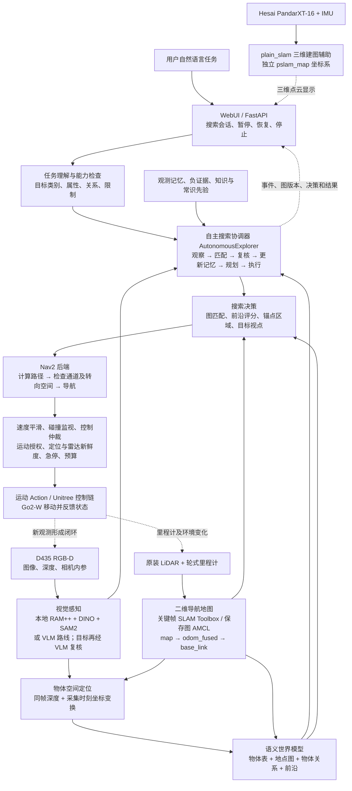

# robotscene 项目系统框架说明

阅读日期：2026-10-16。依据当前工作区源码、配置与启动脚本；包含未提交代码。本文说明模块职责和调用关系，不代表对在线机器人运行状态或真机运动能力的验收。

## 1. 一句话认识项目

这是一个面向 **Unitree Go2-W 机器狗的自然语言目标搜索系统**：用户说出要找什么，系统通过相机识别物体、通过雷达与里程计确定空间和通行条件，结合地图与记忆选择下一观察位置，让机器狗移动后继续观察，直到确认并接近目标，或者报告停止、失败、预算耗尽等结果。

可以把它理解为：**会听任务的机器狗 + 视觉识别 + 空间地图 + 搜索策略 + 导航执行 + 监控界面**。

项目采用分层、模块化的混合架构：大模型参与任务理解、视觉复核和常识先验；显式图结构记录对象、地点与关系；确定性算法负责候选评分、路径检查、状态转换和运动门控。当前搜索主链没有让单个模型直接从图像输出关节控制量。

## 2. 系统框架图

完整图：[SVG 矢量图](项目系统框架图_20261016.svg) · [PNG 图片](项目系统框架图_20261016.png) · [Graphviz 源文件](项目系统框架图_20261016.dot)。

图中的框是职责分组，并非每个框对应独立进程。`AutonomousExplorer` 通过回调组织观察、匹配、复核、候选生成和执行；多个语义与规划模块在同一个搜索 worker 进程内协作。

## 3. 六个主要部分

### 3.1 用户交互与任务理解：先弄清楚要找什么

例子：“寻找饮水机旁边的蓝色垃圾桶”。系统要提取：目标是垃圾桶，属性是蓝色，关系锚点是饮水机，关系是旁边。任务理解还会检查任务是否在当前机器狗能力范围内。

主要代码：

- `app/manual_web_demo/web_server.py`、`search_routes.py`：网页和 API。
- `app/manual_web_demo/search_session_service.py`：任务生命周期、任务理解、控制权与 worker 管理。
- `app/task_understanding/task_pipeline.py`、`llm_task_interpreter.py`、`capability_gate.py`：语言解析和能力检查。
- `app/reasoning/target_profile.py`：生成供检测与推理使用的目标画像。

`SearchTaskContext` 是结构化任务上下文，`TargetProfile` 是检测和搜索使用的画像，两者承担不同职责。当前 runner 还会解析目标画像，其 LLM 接入受配置开关控制，不能认为所有入口都自动采用相同的解析方式。

### 3.2 视觉感知：看见什么，以及它是不是目标

代码支持两条视觉路线。

| 路线 | 组成 | 主要用途 |
| --- | --- | --- |
| 本地检测路线 | RAM++ → 检测词；GroundingDINO → 物体框；SAM2 → 实例掩码；VLM → 目标复核及漏检兜底 | 同时获取目标候选和普通场景物体，支持基于掩码的深度几何 |
| VLM 路线 | 快速目标判断 + 后台完整场景语义 + 目标复核 | 用视觉语言模型理解目标和场景；通常没有真实实例掩码 |

RAM++ 给的是“画面可能有哪些类别”，它不能决定任务目标是否存在。目标词独立来自目标画像。SAM2 负责把框内物体的像素分开，是否运行以及分数门槛由配置控制。

检测后的结果还会按职责分成 `target_candidates`（目标候选）、`relation_anchors`（关系锚点）和 `scene_objects`（其他场景物体）。锚点可同时属于场景物体。检测分数高、目标类别命中和完整目标成立，是不同层次的证据；复杂颜色或关系目标仍需复核。

主要代码：

- `app/detectors/grounded_sam_subprocess.py`、`grounded_sam_worker.py`：常驻本地模型进程与检测协议。
- `app/detectors/siliconflow_vision_daemon.py`、`siliconflow_vision_worker.py`：VLM 调用服务。
- `app/perception/entity_roles.py`、`target_state.py`：候选职责和目标状态。
- `app/live_robot/async_semantic_observer.py`：后台场景语义更新，保留来源帧与采集位姿。
- `scripts/go2w/run_semantic_exploration.py` 中的 `observe()`、`matcher()`、`verifier()`：将感知模块接入搜索闭环。

当前也有检测分频和异步复核实现，但是否启用由配置决定。后台场景语义采用有限并发和最新待处理帧合并，避免积压旧画面。

### 3.3 空间感知与世界模型：把“画面里的东西”变成“空间里的东西”

D435 提供同一帧的 RGB、深度与内参。物体框或掩码在深度图上取样后，先得到相机坐标；只有坐标变换与定位证据满足要求时，才转换到地图坐标。跨帧合并物体后，系统才能记住“刚才看到的那把椅子”和“现在看到的椅子”是否属于同一持久对象。

世界模型主要包含：

- **物体表 `SemanticObjectMap`**：类别、坐标、置信度、来源观测与持续身份。
- **地点图 `PlaceGraph`**：到过哪些地点，地点之间怎样连接。
- **前沿 `Frontier`**：地图中已知可通行区域与未知区域的边界，用来提出探索位置。
- **关系 `ObjectRelationStore`**：物体之间可支持的空间或语义关系。
- **统一图 `SemanticNavigationGraph`**：组织地点、物体、前沿与关系，向 Web 发布统一快照。

主要代码在 `app/perception/depth_object_localizer.py`、`app/spatial/`。网页“对象拓扑”是统一图的物体视图，导航内部仍然使用地点与前沿。

### 3.4 自主搜索：决定下一步去哪儿看

`AutonomousExplorer` 是主协调器，正常反复执行：

`检查后端 → 获取观察 → 匹配目标/关系 → 必要时复核 → 更新图与记忆 → 生成并选择目标 → 执行 → 等结果 → 再观察`

它还处理暂停、停止、等待地图、感知重试、卡死识别、恢复和预算限制。

策略层分工：

- `GoalGraphBuilder` / `SemanticNavigationGraphMatcher`：将任务表达成目标图，与观察到的场景图匹配。
- `SpatialSearchReasoner` / `LongTermGoalSelector`：结合语义相关度、信息增益、路程、已访问惩罚、失败记录等，选择探索前沿、检查锚点区域或目标观察位置。
- `LocalGoalExecutor`：把搜索意图变成后端可执行的导航目标。
- `ViewpointPlanner` / `ClearanceMap` / `RecoveryManager`：结合净空、视觉质量和卡死状态处理局部候选与恢复。
- `app/memory/`、`SpatialMemory`、`SemanticSearchMemory`：保存过去看过什么、哪些方向没有目标、哪些前沿已经试过等信息。

PSG（预测场景图/语义先验）和常识知识用于提出搜索假设或影响排序，不能当作已观察事实。V2 的 `RuleSemanticPriorProvider` 本身是规则实现；`task_agent.py` 也是确定性计划与解释整理模块，不能仅凭“Agent”名字把它理解为另一个自主调用模型的控制器。

### 3.5 导航与运动：把观察位置落实为可检查的路径

正常真实搜索后端是 `Nav2SearchBackend`。其核心链路是：

`地图坐标中的目标位姿 → ComputePathToPose → 路径及通道/转向检查 → NavigateToPose → 控制器速度 → 平滑和监视 → 仲裁 → 运动桥 → /go2w/motion → Unitree 控制链`

在 Nav2 模式下，观察转向也表达为“当前位置 + 目标朝向”。这条后端明确拒绝相对平移指令，不会在 Nav2 不可用时自动切换到旧后端。

控制仲裁处理手动、Nav2 和搜索来源的优先级；速度桥检查执行开关、操作员 arm、租约、雷达和定位新鲜度、急停、遥控接管与命令超时等。短距验收档另外使用持久预算和里程计约束。

主要代码在 `app/navigation/nav2_search_backend.py`、`corridor_analyzer.py`，ROS 包 `robot_scene_nav_bringup`、`go2w_control_arbiter`、`go2w_cmd_vel_bridge`，以及 `unitree_go2w_control/ros2_ws/src/go2w_motion_control/`。

正常网页默认 `finish_on_visual_confirmation=false`：视觉确认后，还需目标定位、接近规划、执行、最终观察与复核。类本身或其他入口支持视觉确认即结束的模式，因此要看启动参数，不能把“看见目标”统一等同于“已经走到目标”。

### 3.6 展示与记录：解释每一步为什么发生

FastAPI Web 进程与 ROS 搜索 worker 通过 stdin/stdout JSONL 通信。这样网页服务和 ROS/模型依赖可以运行在不同 Python 环境。视觉模型另有常驻 worker/daemon，避免每帧重新加载模型。

搜索事件进入统一状态存储与界面；语义图按 `revision` 变化发送快照，普通事件携带版本信息，避免每条事件传输整张图。主要实现见 `search_executor.py`、`search_event_bus.py`、`search_state_store.py` 和 `autonomous_search_worker.py`。

`outputs/live_runs/<session_id>/` 保存任务、事件、决策、地图、终态和摘要，支持查看依据与回放。`runtime/` 与 `outputs/autonomous_search/runtime/` 则用于帧缓存、PID、套接字和现场中间态。

## 4. 最容易混淆的三种地图

| 地图 | 通俗理解 | 关键数据/模块 | 正常职责 |
| --- | --- | --- | --- |
| 二维导航地图 | 地板上哪里能走、哪里有障碍、哪里没看过 | `/map`，SLAM Toolbox；保存图用 AMCL；`Nav2SpatialProvider` | 导航、定位、前沿提取与路径检查 |
| 三维几何地图 | 环境的立体形状 | PandarXT-16 + IMU + plain_slam，独立 `pslam_map` | 三维建图辅助与 Web 点云展示 |
| 语义与拓扑图 | 有什么物体、在哪里、什么关系、到过哪些地点 | `SemanticNavigationGraph`、`SemanticObjectMap`、`PlaceGraph` | 目标搜索、跨帧记忆与解释 |

三者可以通过有依据的坐标和观测关联协作，但用途不同。普通三维点云本身不含“蓝色垃圾桶”语义，也不能仅因三维地图正常就认定二维导航条件满足。

当前二维建图具体使用：原装 LiDAR 预处理 → 密集/运动关键帧 → 项目适配的 SLAM Toolbox → 原始地图 → 实际地面观测补充 → `/map`。轮式里程计负责 `odom_fused → base_link`，SLAM 或 AMCL 负责 `map → odom_fused`；当前启动检查要求轮式里程计关闭 LIO 修正，避免三维建图辅助与导航 TF 混用。

## 5. 当前入口及默认值应怎样理解

| 入口 | 用途 |
| --- | --- |
| `scripts/go2w/start_nav2_autonomous_search.sh` | 正常二维 Nav2 搜索装配入口；默认只规划，执行依赖显式开关及其他门控 |
| `scripts/go2w/start_autonomous_search_web.sh` | Web/worker 启动入口；正常模式设定 Nav2 后端与 Nav2 空间提供者，也保留显式旧后端试验选项 |
| `scripts/go2w/autonomous_search_worker.py` | Web 后台搜索进程；命令接收、事件和图快照输出 |
| `scripts/go2w/run_semantic_exploration.py` | 装配感知、世界模型、推理、后端与 `AutonomousExplorer` 的主脚本 |
| `run_demo.py` / `run_video_demo.py` | 图片/视频分析与离线算法实验 |
| `run_live_robot_demo.py` | 基于实时帧包的观察入口，当前明确限制为 `observe_only` |
| `streamlit_app.py` | 较早的综合演示/实验界面；与当前 FastAPI 真机 Web 入口并存 |

两个已通过源码核实的区别：

1. CLI `--detector` 裸默认是 `llm`；当前网页 YAML 选择 `grounded_sam`。网页配置、请求和运行环境仍会影响实际路线，本文没有读取含凭据的 `.env`。
2. 网页 YAML 仍写 `plain_slam` 空间提供者，但正常 Web 启动脚本会用环境变量覆盖为 `nav2`；只有显式旧相对运动试验分支保留 `plain_slam`。因此不能只依据 YAML 注释绘制当前导航架构。

## 6. 目录与技术栈

| 目录 | 职责 |
| --- | --- |
| `app/manual_web_demo/` | FastAPI 网页、API、会话与前端 |
| `app/task_understanding/` | 自然语言任务理解、能力检查 |
| `app/detectors/`、`app/perception/` | 模型检测、候选分类、RGB-D 与物体定位 |
| `app/live_robot/` | 真机观察与搜索协调、状态和事件 |
| `app/spatial/`、`app/slam/` | 地图接入、坐标变换、对象/地点/前沿图 |
| `app/reasoning/`、`app/memory/`、`app/knowledge/` | 图匹配、先验、记忆和知识检索 |
| `app/navigation/`、`app/planning/` | 意图与候选、路径与执行、安全约束 |
| `app/video/`、`app/services/` | 图片/视频场景分析、图构建与离线处理 |
| `scripts/go2w/`、`configs/go2w/` | 真机启动、诊断、标定、运行配置 |
| `ros2_ws/src/` | ROS 2 传感器、SLAM/定位、融合、导航与控制桥接节点 |
| `unitree_go2w_control/` | Go2-W 底层控制、运动 Action、租约和诊断 |
| `point_lio_ws/`、`external/` | 其他建图路线及第三方模型/依赖；目录存在不表示当前主链正在调用 |
| `tests/`、`reports/`、`artifacts/`、`outputs/` | 行为约束、实验结论、验证证据与运行产物 |

应用以 Python 为主，使用 FastAPI、前端 JavaScript、NumPy/OpenCV、图结构及模型调用；机器人侧通过 ROS 2 节点、Action、Topic 和 TF 协作，部分 SLAM 与底层控制使用 C++。典型部署分为外接 Ubuntu 控制主机和 Go2-W，两端通过网络连接；具体进程归属依启动方式而定，并非每个模块固定部署在一台机器上。

## 7. 代码具备的链路与现场可用性要分开看

当前源码已包含任务到观察、图与记忆、搜索决策、Nav2 执行及目标接近的完整结构，也保留 Mock、回放、旧相对运动和多种地图接入方案。旧阅读指南中的 VLM-only 默认与部分旧文档中的三维导航描述，不能直接代表现在的正常启动链。

这次仅做静态阅读与框架图整理，没有启动机器人、改变运动配置或执行现场验收。当前仓库 `configs/go2w/navigation_gate.yaml` 中 `nav2_allow_execute` 仍为 `false`；因此本文不将“已有执行代码”描述成“大场地自主搜索已通过”。具体在线状态应另以实时检查和物理验证为准。
